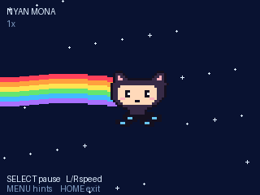

# Nyan Mona for Badger 2350



A self-contained pixel animation for the **Universe 2026 MonaOS runtime** linked from https://badger.github.io/. Includes an original pixel-art interpretation of GitHub’s Mona the Octocat with flexing tentacles, a wavy rainbow trail of GitHub contribution squares, parallax stars, pause, and five speeds. The squares scroll with varied activity brightness in six rainbow rows. No downloads, Wi-Fi, or audio required.

## Install

1. Unzip the download. Keep `__init__.py` and `icon.png` together in the `nyan_mona` folder.
2. Connect your badge with a USB data cable, then quickly press RESET twice to enter BADGER disk mode.
3. Visit https://badger.github.io/apps/, choose **Open BADGER disk**, and select the BADGER drive root. Under **Add local app**, choose the `nyan_mona` folder and apply the queued installation.
4. Safely eject BADGER, press RESET once, and open Nyan Mona from the menu.

Alternatively, copy `nyan_mona` into the writable `apps` folder on the BADGER disk. The runtime discovers app directories containing `__init__.py`. Do not copy files onto an RP2350 firmware drive.

## Controls

- SELECT: pause / resume.
- LEFT / RIGHT: select 0.5x, 1x, 1.5x, 2x, or 3x speed.
- UP: toggle the motion response, shown as MOTION ON or MOTION OFF.
- MENU: hide / show controls.
- HOME: return to MonaOS (handled by the operating system).

Move the badge to give Mona and her trail a small temporary lean, capped at
10 degrees, and a gentle extra rainbow ripple. Hold it still at any angle and
Mona eases back to screen-upright while the rainbow returns to its normal wave.
The contribution squares remain distinct. This replaces gravity leveling;
stars and text stay fixed to the screen.

The motion response starts disabled each time the app opens. Press the front
UP button to enable it at the badge's current resting angle; press UP again to
ease Mona upright. The response remains active while paused and does not depend
on animation speed. Laying the badge flat also eases Mona upright. Automatic
screen flipping is disabled in the app and restored on exit.

For the developer simulator at https://badger.github.io/, replace the example app code with `__init__.py` and run it.

Targets the 2026 graphics/input API; not the older e-ink Badger or 2025 runtime. Checked with a host-side runtime stub; actual badge display and buttons still require device testing.

## Development

This repository includes [hyb26-skill](.github/skills/hyb26-skill/SKILL.md)
with its scripts, references, and tests. Copilot discovers it in
`.github/skills/`; [AGENTS.md](AGENTS.md) directs badge work to it. No personal
skill installation is required.

With Python 3.10 or newer, run static validation from the repository root:

```bash
python3 .github/skills/hyb26-skill/scripts/validate_app.py ./nyan_mona
python3 -m unittest discover -s tests
```

The app stays in `nyan_mona/`. Use that path instead of the skill's example
`badge/apps/<name>` paths. Static checks do not replace testing the display,
buttons, HOME/re-open behavior, and menu icon on a physical badge.

For motion, enable UP while holding the badge at an angle and check that Mona
does not lean until the badge moves. Turn it both ways and check for a small
temporary lean and stronger rainbow ripple. Hold it still at the new angle for
a few seconds and check that Mona returns to screen-upright and the ripple
settles. Cross upside-down to check for jumps, then lay it flat in both
directions. Repeat while paused and at each speed. Toggle UP in both paused and
running states, and check that the contribution squares remain distinct with
no thin rainbow line in front of Mona.
Press HOME and reopen to check that the launcher's automatic screen orientation
has been restored.

### Updating the bundled skill

The bundled copy comes from the `hyb26-skill` personal installation. After
updating that installation, refresh the repository copy from a macOS or Linux
terminal at the repository root. This does not require an AI session:

```bash
rsync -a \
  --exclude='__pycache__' --exclude='*.py[cod]' \
  --exclude='.DS_Store' --exclude='._*' \
  "$HOME/.copilot/skills/hyb26-skill/" .github/skills/hyb26-skill/
python3 -m unittest discover -s .github/skills/hyb26-skill/tests
```

Review the changes before committing. The copy keeps destination-only files;
check upstream removals separately. In an open Copilot CLI session, use
`/skills reload` or restart the session to load the updated skill.

This is an unofficial fan-made mascot animation, not an official GitHub asset. The original Nyan Cat app remains a separate installation.
